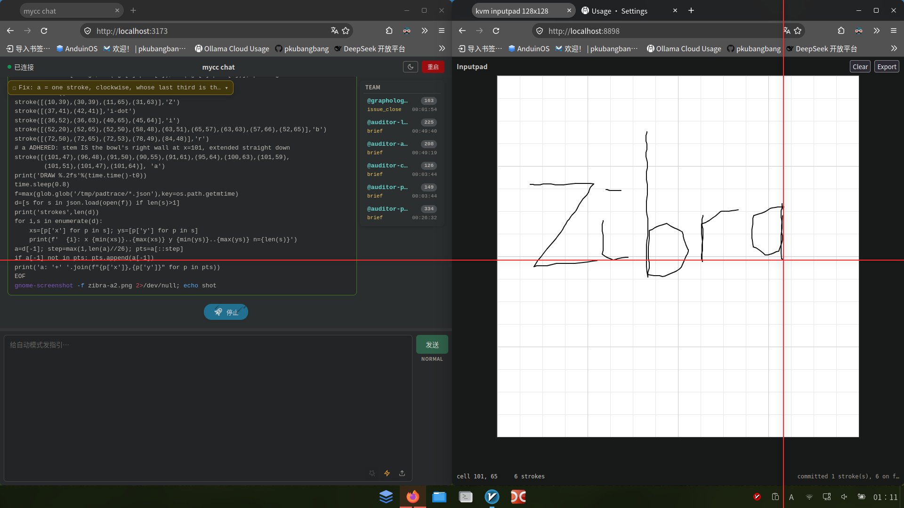
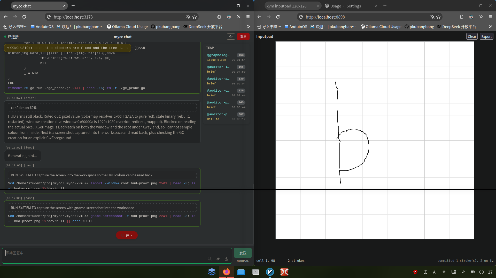

# kvm — drive a CH9329 USB-HID bridge as a real mouse and keyboard

`kvm` turns a CH9329 serial HID bridge (the cheap "CH9329 USB to serial" chip) into
a **programmable, sub-pixel-accurate input device**: it places the pointer at an
exact screen coordinate, draws strokes that match a human hand, and types text —
all from a Linux command line, with no compositor cooperation required.

This repository is the toolchain behind a series of rig experiments: drawing the
letter **Z** and the word **"Zibra"** on a tablet input pad with measurable
fidelity, and driving a browser (PaintZ) end to end.

> **Hardware:** CH9329-based USB→HID bridge on `/dev/ttyACM0` at 115200 baud.
> Without the chip attached the build still works; `kvm mouse ...` returns a
> device error.

---

## Contents

| Path | What it is |
|---|---|
| `cmd/kvm` | The CLI: `mouse abs`, `mouse rel`, `mouse pos`, `mouse hud` |
| `cmd/kvm-crosshair` | Standalone X11 overlay drawing a crosshair at the reported cursor position |
| `cmd/kvm-inputpad` | HTTP pad server (embedded page, `127.0.0.1:8898`) recording strokes into a 128×128 cell grid and exporting traces as JSON |
| `extensions/kvm-cursor-report@mycc` | GNOME Shell extension publishing the compositor's pointer position into a shared-memory ring |
| `internal/mouse` | Motion core: absolute placement, relative ink, ACK-paced transport, human-motion profile |
| `internal/cursor` | Reader for the cursor ring (`/run/user/<uid>/kvm-cursor.ring`) |
| `internal/cli`, `internal/config` | Argument grammar and configuration |
| `internal/capture`, `internal/crosshair` | Screen capture and crosshair rendering |
| `scripts/` | Python rigs used to draw, trace and certify glyphs |
| `reference/pad-trace-raw.json` | The author's own handwriting trace, used as ground truth |
| `third_party/ch9329` | Vendored copy of the [ch9329](https://github.com/pkubangbang/ch9329ctl) driver (separate module, wired by `replace`) |
| `PITFALLS.md` | 14 sections, 80+ numbered pitfalls measured on this rig — read before changing motion code |
| `Zibra-Z.md` | Recorded procedure for drawing a Z with certifiable evidence |
| `analysis.md` | The motion analysis that produced the design |

---

## Build

Go **1.25** or newer.

```bash
go build ./...                       # library + all three binaries
go build -o kvm ./cmd/kvm            # the CLI
go build -o kvm-crosshair ./cmd/kvm-crosshair
go build -o kvm-inputpad ./cmd/kvm-inputpad
```

`third_party/ch9329` is a **nested module** (it has its own `go.mod`); the root
`go.mod` wires it in with a relative `replace`, so no network checkout and no
sibling repository is required. Test it separately:

```bash
go test ./...
(cd third_party/ch9329 && go test ./...)
```

---

## CLI

```
kvm mouse abs move X Y           # place the pointer exactly (one absolute 0x04 report)
kvm mouse rel [flags] down|up    # button
kvm mouse rel [flags] move DX DY # one relative report
kvm mouse rel [flags] drag DX DY # move with the button held (repeatable, one span)
kvm mouse rel [flags] wait MS    # pause inside a span
kvm mouse pos                    # read the pointer back (ring → tracker)
kvm mouse hud on|off             # crosshair overlay
```

Flags (`mouse rel`, and `-human` anywhere on the line):

| Flag | Meaning |
|---|---|
| `-human[=bool]` | Human-motion profile (ease-in/out, corner dwell, variable step, tremor). Default on for ink. |
| `-step N` | Max pixels per report |
| `-gap N` | Milliseconds between reports (ACK-paced, floor 8 ms) |
| `-ease`, `-origin`, `-dry-run` | Easing, coordinate origin, print-without-emit |

**Flag position matters:** put `-human` / `-gap` / `-step` *before* the `mouse rel`
sub-verb list, otherwise a parsed-but-unrouted verb aborts with
`unhandled rel verb "drag"`.

Example — a Z in one held span:

```bash
kvm mouse abs move 1100 200
kvm mouse rel -gap 2 down \
  $(for i in $(seq 50); do printf 'drag 6 0 '; done) \
  $(for i in $(seq 50); do printf 'drag -6 6 '; done) \
  $(for i in $(seq 50); do printf 'drag 6 0 '; done) \
  up
```

---

## How it works

**Two motion paths, deliberately split.**

* **Placement is absolute.** `internal/mouse/absops.go` sends the chip's 0x04
  absolute report; `AbsGoto(1500,500)` lands at (1501,500).
* **Ink is relative.** The 0x04 report drops the button byte, so held spans must be
  relative. A *single* relative report is 1:1, but a *burst* is accelerated by the
  host (~1.5×). The fix is ACK-before-next-report pacing with an 8 ms floor
  (`internal/mouse/transport.go`), which keeps each report honest.

`ErrAbsWhileHeld` guards the boundary between the two.

**Position feedback** comes from the GNOME extension: it writes a magic-prefixed
ring (`KVMR`, 64 slots of 24-byte `seq/x/y/ts`) at ~60 Hz; `internal/cursor` reads
it and treats entries older than 3 s as stale.

---

## The inputpad

`kvm-inputpad -addr 127.0.0.1:8898 -box X,Y,W,H -out /tmp/padtrace` serves a
browser canvas that records every stroke and exports traces as JSON: a
**top-level list** of `{ts,x,y,fx,fy,epoch}` records, in **128×128 grid cells**
(group into strokes by epoch and time gaps — not a `{"strokes": ...}` dict, and
not screen pixels).

The Python scripts in `scripts/` consume that format: `pad_tracecheck.py`
(per-stroke geometry), `pad_corr.py` (paired path error), `pad_coverage.py`
(ink coverage), `glyph_run.py` (draw a glyph and park convergently).

---

## Screenshots

| | |
|---|---|
|  |  |
| Red pentagon + blue incircle, drawn by the CLI in one flat pass | "Zibra" — 6 strokes, 6.31 s of emitted motion |
|  |  |
| The inputpad after Clear | The crosshair HUD following the reported position |

---

## Status and caveats

* **Linux only** for the ring/capture/crosshair paths (X11 for the overlay);
  `cmd/kvm` and the mouse core build anywhere — the device is a serial port.
* Absolute placement on multi-monitor setups is expressed in the chip's address
  space; see `PITFALLS.md` §6.
* This is experimental code written to answer specific measurement questions, not
  a polished input daemon. `PITFALLS.md` is the honest map of what will bite you.

## License

MIT — see [LICENSE](LICENSE). The vendored `third_party/ch9329` driver is also
MIT, © CH9329CTL contributors.
