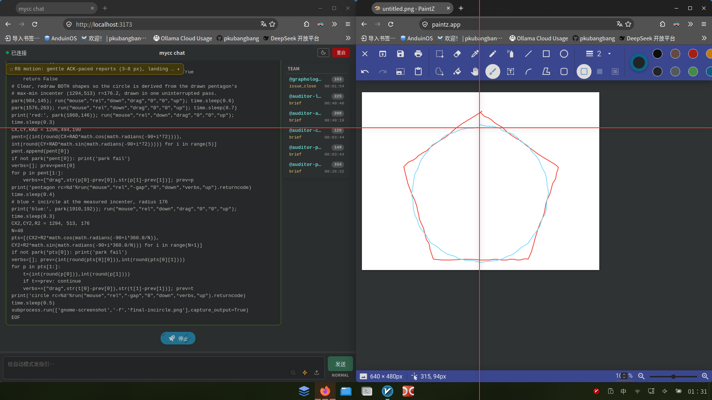
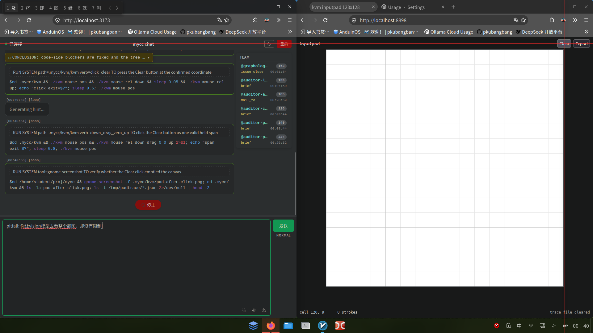

# kvm — drive a CH9329 USB-HID bridge as a real mouse and keyboard

`kvm` turns a CH9329 serial HID bridge (the cheap "CH9329 USB to serial" chip) into
a **programmable, sub-pixel-accurate input device**: it places the pointer at an
exact screen coordinate and draws strokes that match a human hand — from the
command line, with no compositor cooperation required. The vendored driver in
`third_party/ch9329` also carries keyboard primitives (`KeyPress`, `Hotkey`,
`TypeText`), but the `kvm` CLI exposes no typing verb: its only command is
`mouse` (`cmd/kvm/main.go`).

This repository is the toolchain behind a series of rig experiments: drawing the
letter **Z** and the word **"Zibra"** on a tablet input pad with measurable
fidelity, and driving a browser (PaintZ) end to end.

> **Hardware:** CH9329-based USB→HID bridge at 115200 baud. The port default is
> `/dev/ttyACM0` on Linux and `COM3` on Windows (`internal/config/config.go`
> `defaultPort`); it is a starting point that `-port` and discovery both outrank.
> Without the chip attached the build still works; `kvm mouse ...` returns a
> device error.

---

## Contents

| Path | What it is |
|---|---|
| `cmd/kvm` | The CLI: `mouse abs`, `mouse rel`, `mouse pos`, `mouse hud` |
| `cmd/kvm-crosshair` | Standalone overlay drawing a crosshair at the reported cursor position: X11 on Linux, a Win32 layered window on Windows |
| `cmd/kvm-inputpad` | HTTP pad server (embedded page, `127.0.0.1:8899`) recording strokes into a 128×128 cell grid and exporting traces as JSON |
| `cmd/pad-bbox` | Pad dimension detector: locates the three QR "eyes" painted in the canvas corners and prints the pad canvas rect (`-bbox` → `x1 y1 x2 y2`). `-grab` captures the screen in-process (Windows GDI, ~20 ms) instead of reading a PNG (`-shot`, ~2 s via `ffmpeg -f gdigrab` → file) |
| `extensions/kvm-cursor-report@mycc` | GNOME Shell extension publishing the compositor's pointer position into a shared-memory ring |
| `internal/mouse` | Motion core: absolute placement, relative ink, ACK-paced transport, human-motion profile |
| `internal/cursor` | Reader for the cursor ring (`/run/user/<uid>/kvm-cursor.ring`) |
| `internal/cli`, `internal/config` | Argument grammar and configuration |
| `internal/capture`, `internal/crosshair` | Screen capture and crosshair rendering |
| `scripts/` | Python rigs used to draw, trace and certify glyphs |
| `third_party/ch9329` | Vendored copy of the [ch9329](https://github.com/pkubangbang/ch9329ctl) driver (separate module, wired by `replace`) |
| `pitfalls.md` | 19 sections, 80+ numbered pitfalls measured on this rig — read before changing motion code |
| `zibra-z.md` | Recorded procedure for drawing a Z with certifiable evidence |
| `analysis.md` | The motion analysis that produced the design |

---

## Build

Go **1.25** or newer.

```bash
go build ./...                       # library + all three binaries
go build -o kvm ./cmd/kvm            # the CLI
go build -o kvm-crosshair ./cmd/kvm-crosshair
go build -o kvm-inputpad ./cmd/kvm-inputpad
```

On Windows the crosshair must be built as a **GUI binary**, so it has no console
window of its own (`cmd/kvm/hud_windows.go` prints exactly this line when the
sibling binary is missing):

```bash
go build -ldflags "-H windowsgui" -o kvm-crosshair.exe ./cmd/kvm-crosshair
```

`go build ./...` on a host where a package's files are all excluded by build tags
exits 0 and says nothing about that package — a false green, not a pass (measured:
it exits 0 with no output while `go build ./cmd/x` fails with `build constraints
exclude all Go files`). Narrow builds (`go build ./cmd/kvm-crosshair`) are the
honest gate for a platform-specific package; that is `decision-tree.md` A3.

`third_party/ch9329` is a **nested module** (it has its own `go.mod`); the root
`go.mod` wires it in with a relative `replace`, so no network checkout and no
sibling repository is required. Test it separately:

```bash
go test ./...
(cd third_party/ch9329 && go test ./...)
```

---

## CLI

```
kvm [-port PORT] mouse abs move X Y          # place the pointer exactly (one absolute 0x04 report)
kvm mouse rel [flags] down|up|rdown|rup      # button, left or right
kvm mouse rel [flags] move DX DY             # one relative report
kvm mouse rel [flags] drag DX DY             # move with the button held (repeatable, one span)
kvm mouse rel [flags] wait MS                # pause inside a span
kvm mouse pos                                # read the pointer back (ring on Linux, GetCursorPos on Windows)
kvm mouse hud on|off                         # crosshair overlay
```

The verb set is closed: `move`, `down`, `up`, `rdown`, `rup`, `drag`, `wait`,
plus the out-of-namespace `pos` and `hud`. There is no `probe` verb and no
`plan`/`fire` wrapper — `-dry-run` is the predict mode (`cmd/kvm/main.go`,
`internal/cli/parse.go`).

`rdown` / `rup` are the right button as first-class verbs, not a `-button` mode:
`rdown` presses at the pointer's current position, `rup` releases it there. Both
have arity 0 and share the `down`..`up` latch: `rdown` is legal only while the
button is up and opens the span; `rup` closes it, and is also legal with the
latch already up because it releases where the pointer is. So a right-button drag
is `rdown drag DX DY rup`. A line left open is completed with an appended
release rather than refused — `rdown drag DX DY` parses as three verbs plus a
final `up` (`Parse`, `internal/cli/parse.go`).

Flags:

| Flag | Position | Meaning |
|---|---|---|
| `-port PORT` | **top-level, before `mouse`** | Serial port; overrides the discovered/default one |
| `-human[=bool]` | anywhere on the line | Human-motion profile (ease-in/out, corner dwell, variable step, tremor). Default on for ink. |
| `-button NAME` | anywhere on the line | Button carried by `down`/`drag`: `left`, `right` or `middle`. Default `left`. |
| `-origin` | anywhere on the line | Home to the top-left corner first (relative mode, single segment) |
| `-dry-run` | anywhere on the line | Validate and print, send nothing |
| `-baud N` | **top-level, before `mouse`** | Serial baud rate |

**`-port` is a top-level flag.** It must come before the namespace:
`kvm -port COM3 mouse abs move X Y` works, `kvm mouse abs -port COM3 move X Y`
fails with `unknown verb "-port"`. The other flags are re-scanned out of the
argument list (`cmd/kvm/main.go`), so they may appear after `mouse rel`.

Example — a Z in one held span:

```bash
kvm mouse abs move 1100 200
kvm mouse rel down \
  $(for i in $(seq 12); do printf 'drag 25 0 '; done) \
  $(for i in $(seq 12); do printf 'drag -25 25 '; done) \
  $(for i in $(seq 12); do printf 'drag 25 0 '; done) \
  up
```

Report size is not a tuning knob: it is `mouse.HeldStepPx` (20 px), and the
dry-run estimate uses that same constant. Pacing inside a span is fixed; use the
`wait MS` verb if a pause is actually wanted, rather than sleeping between
separate `kvm` invocations — each invocation is its own span.

On Windows the same line uses the COM port:

```bash
kvm -port COM3 mouse abs move 1100 200
```

---

## The crosshair overlay (`mouse hud`)

`kvm mouse hud on` starts the overlay; `kvm mouse hud off` asks it to stop. The
overlay is a **singleton**: `cmd/kvm-crosshair` holds a named mutex
(`Local\kvm-crosshair-overlay` on Windows, an `flock` on Linux), so a second copy
exits quietly and a second `hud on` is a no-op. `hud on` spawns the sibling
`kvm-crosshair` binary detached, so the overlay outlives the command and the
terminal that started it; `hud off` signals the running daemon over a control
channel (`\\.\pipe\kvm-crosshair` on Windows, a unix socket on Linux) and prints
`kvm: crosshair off`, or `kvm: crosshair already off` when nothing was running —
not running is the desired end state, not a failure.

The overlay reads the pointer from the same witness the motion path uses — the
GNOME extension's ring on Linux, `GetCursorPos` on Windows
(`internal/mouse/shellpos_windows.go`) — so it can never disagree with the tool
about where the pointer is.

`internal/crosshair` draws full-screen 1 px arms with a solid crossing, in red
(`internal/crosshair/render.go`). On Windows the surface is a 32-bit BGRA DIB and
the transparency mode is `UpdateLayeredWindow` with `ULW_COLORKEY`, key colour
black — which also means a black overlay pixel would be invisible. See
`pitfalls.md` §15.

---

## How it works

**Two motion paths, deliberately split.**

* **Placement is absolute.** `internal/mouse/absops.go` sends the chip's 0x04
  absolute report; `AbsGoto(1500,500)` lands at (1501,500).
* **Ink is relative.** The 0x04 report drops the button byte, so held spans must be
  relative. A *single* relative report is 1:1, but a *burst* is accelerated by the
  host (~1.5×). The fix is ACK-before-next-report pacing with an 8 ms floor
  (`internal/mouse/transport.go`), which keeps each report honest.

`ErrAbsWhileHeld` guards the boundary between the two.

**Position feedback** comes from the platform witness: on Linux the GNOME
extension writes a magic-prefixed ring (`KVMR`, 64 slots of 24-byte `seq/x/y/ts`)
at ~60 Hz and `internal/cursor` reads it, treating entries older than 3 s as
stale; on Windows `GetCursorPos` is the witness and there is nothing to publish
(`internal/mouse/shellpos_windows.go`).

**Right-button spans.** `rdown` swaps the controller's button mask to
`ch9329.BtnRight` for the span and restores the previous mask when the command
ends (`cmd/kvm/exec.go`), so a right span cannot leak into a later `down` on the
same command line.

---

## The inputpad

`kvm-inputpad -addr 127.0.0.1:8899 -box X,Y,W,H -out strokes.d` serves a browser
canvas that records every stroke and exports traces as JSON. Defaults:
`-addr 127.0.0.1:8899`, `-out strokes.d` (`cmd/kvm-inputpad/main.go`).

Each client writes its **own** file, `<out>/<client-id>.json`, and the directory
also holds `events.jsonl` with one line per action (stroke, clear, client-new).
A trace file is an **array of strokes**, each stroke an array of
`{ts,x,y,fx,fy,rx,ry,epoch}` points. `rx`/`ry` are **pure ratios of the canvas
CSS box** in [0,1] and are the authoritative position — they are what the page
draws from and what every reader must use (see *Coordinates* below). `x`/`y` are
a 128-lattice rounded derivative kept for older readers, and `fx`/`fy` are the
in-cell offsets of that same lattice; nothing draws from them any more. The
client id comes from the page's `sessionStorage` with a `localStorage` fallback,
so a reload continues the same file and a second tab gets its own.

Cells map with **one** division per axis (`cmd/kvm-inputpad/main.go`, `pos`):

```js
u = clamp((e.clientX - r.left) * N / r.width)    // N = 128
v = clamp((e.clientY - r.top)  * N / r.height)
```

`N` is the 128-cell count and `r` is the canvas's live `getBoundingClientRect()`.

### Coordinates: ink-space and screen-space are NOT the same space

This is the single most expensive confusion in this project; it has produced
three wrong root causes and several "the pad is misaligned" reports that were
really unit errors. The two spaces have different origins and different units,
and no arithmetic may mix them.

| | **ink-space** | **screen-space** |
|---|---|---|
| Origin | the canvas's own top-left corner | the screen's top-left pixel |
| Unit | a fraction of the canvas CSS box (`rx`, `ry` in [0,1]) | one physical screen pixel |
| Range | 0..1 per axis | 0..1919 x 0..1079 on this rig |
| Produced by | the page's `pos()` — the trace file | `mouse abs move` / `mouse pos` |

A recorded point is a fraction of the canvas box. `rx x 454` on a 454 px box is
an **inset** — a distance from the canvas corner — and **not** a screen
coordinate. Reading it as one is the **inset error**.

The bridge between the spaces is exactly one quantity, the pad's **anchor**: the
**screen** coordinate of the canvas's top-left corner, in screen pixels.

```
screen = anchor + ink x extent      # ink-space -> screen-space
ink    = (screen - anchor) / extent # screen-space -> ink-space
```

`extent` is the canvas's on-screen size (the CSS box, measured once from a
screenshot and recorded in `scripts/pad_calib.json`), and `anchor` is a
screen pixel pair that **must be measured, never inferred**:

1. place the pointer with `kvm mouse abs move X Y` — screen-space, exact;
2. click there (`mouse rel down drag 1 0 up` — one press/release, one process);
3. read that point's `rx`,`ry` from the pad's own record — ink-space, exact. The page
   POSTs each finished stroke to `/api/log`; `store.go` appends it to the newest
   `strokes.d/<client>.jsonl`, so the record is a file, not an endpoint. (The old
   read-back endpoint is gone for good — see `pad-protocol.md` §5.)
4. `anchor = (X, Y) - (rx x extent.w, ry x extent.h)`.

Take the anchor from **two well-separated clicks** and test it on a **third**;
solving the anchor from the very points it is supposed to explain is circular
and was the **anchoring error** in this project (invented anchors of 978, 1117
and 1120 screen px, each fitted from the trace and each wrong).

Consequences worth stating, because they are how to tell the errors apart from a
single report:

* A wrong **anchor** shifts every recorded point by the same screen amount. On a
  click at the grid's **left edge** it reads as "the point landed right of the
  cursor" and the offset is the SAME everywhere.
* A wrong **extent** (one isotropic px-per-cell, or the backing-store size
  instead of the CSS box) scales the error with distance from the corner: zero
  at the corner and growing outward — the **extent error**.

Two further traps already measured on this rig:

* The pad's own geometry is reported in **CSS px relative to the page viewport**,
  while screen-space is desktop px. Converting between them needs the window's screen
  origin plus any viewport offset; the pad on this rig is a VS Code webview
  pane, so the two differ by more than a thousand pixels. Do not feed a screen
  pixel to `pos()`-derived maths, and do not feed a viewport rect to `mouse abs
  move`. This is why the anchor is MEASURED from the page's own painted corner
  markers (`scripts/pad_bbox.py`) rather than asked of the server.
* The canvas box can be **non-square** (CSS `max-width`/`max-height`), so
  ink-to-px needs **one divisor per axis** (`w` for x, `h` for y). A single
  px-per-cell is the special case, not the rule.

The Python scripts in `scripts/` consume that format: `pad_tracecheck.py`
(per-stroke geometry), `pad_corr.py` (paired path error), `pad_coverage.py`
(ink coverage), `heart_check.py` (turning-point/shape detector over a trace: vertices,
curvature sign flips, tip, cleft, lobes, closure, aspect — the only shape
verdict this project accepts), `heart_draw.py` (emit one CLOSED heart stroke
whose legs are asserted to sum to zero, priced against the measured per-report
cost so the stroke fits a wall-clock budget).

---

## Screenshots

| | |
|---|---|
|  |  |
| Red pentagon + blue incircle, drawn by the CLI in one flat pass | "Zibra" — 6 strokes, 6.31 s of emitted motion |
|  |  |
| The inputpad after Clear | The crosshair HUD following the reported position |

---

## Status and caveats

* **Linux and Windows** for the pointer witness: the ring + GNOME extension on
  Linux, `GetCursorPos` on Windows. The crosshair overlay has both
  implementations (X11 and Win32). Screen capture is X11-only
  (`internal/capture/capture_x11_linux.go`), and `mouse hud` fails loudly on any
  other platform (`cmd/kvm/hud_other.go`).
* Absolute placement on multi-monitor setups is expressed in the chip's address
  space; see `pitfalls.md` §6.
* This is experimental code written to answer specific measurement questions, not
  a polished input daemon. `pitfalls.md` is the honest map of what will bite you.

## License

MIT — see [LICENSE](LICENSE). The vendored `third_party/ch9329` driver is also
MIT, © CH9329CTL contributors.
